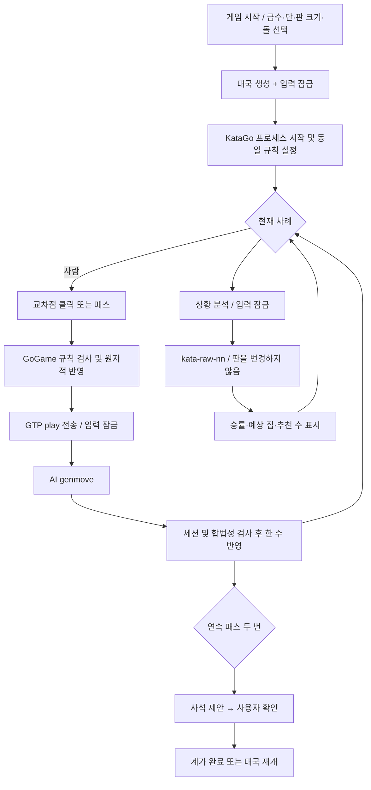

# 한 수 · Baduk Studio 개발 및 배포 가이드

실제 바둑 규칙과 등급별 AI 대국을 구현한 Unity 게임의 개발 기록입니다. 최초 요구사항, 구현 순서, 시행착오, 상황 분석과 예상 집 확장, 테스트, 공개 전 정리까지 한 문서로 연결합니다.

문서 구성은 제공된 빌드 가이드의 **결과물 → 구조 → 명세 → 구현 순서 → 검증 → 주의점 → 현재 상태** 흐름을 참고했습니다. 다른 프로젝트의 실행 지시, 서비스 설정, 키 이름과 부록 코드는 가져오지 않았습니다. 이 프로젝트의 원본 코드는 실제 파일로 함께 제공하므로 문서 끝에 다시 중복하지 않습니다.

**기준일:** 2026-11-01 · **기능 버전:** 1.1.0 · **대상:** Windows x64

---

## 1. 출발점과 요구사항

최초 목표는 Unity로 바둑 게임을 만드는 것이었습니다. 필수 요구사항은 세 가지였습니다.

1. 게임 시작 후 상대 AI의 실제 바둑 급수·단을 선택할 수 있어야 한다.
2. 사람이 연속 클릭하거나 AI가 응답하는 동안에도 돌이 동시에 놓이지 않아야 한다.
3. 화면 하단에 작은 상황 분석 버튼이 있어야 한다.

이후 **상황 분석 시 내 집이 어디인지 바둑판에 표시**하는 요구가 추가됐습니다. 마지막 단계에서는 개발 과정을 문서화하고, 기보·개인정보·키가 없는 공개 배포물을 준비했습니다.

### 설계에서 정한 기준

- 규칙은 중국식 온라인 면적 계가로 명확히 고정했습니다. 국가별 바둑 규칙을 혼합하지 않았습니다.
- 임의의 쉬움/보통/어려움 대신 KataGo의 실제 HumanSL 등급 프로필을 사용했습니다. 다만 기보 스타일 모방과 공인 기력을 구분했습니다.
- 규칙 모델, 외부 엔진 통신, Unity 화면을 분리했습니다.
- 모든 AI 결과는 현재 대국 세션에 속하는지 확인하고 반영합니다.
- 상황 분석은 판 상태를 바꾸지 않습니다. 최종 계가와 분석 추정을 분리합니다.

## 2. 최종 결과물

| 영역 | 구현 내용 |
|---|---|
| 시작 화면 | 한 수 / Baduk Studio, 한국어 안내, 게임 시작 버튼 |
| 대국 설정 | 20급~1급, 1단~9단 / 9·13·19줄 / 흑·백 |
| 규칙 | 교대 착수, 중복 착수 방지, 활로, 따내기, 자충, 위치 슈퍼코 |
| 종료 | 패스, 연속 두 번 패스 후 사석 확인, 계가, 재개, 기권 |
| 분석 | 흑 승률, 예상 집수 차이, 추천 좌표, 단수 경고 |
| 예상 집 | 내 영역과 상대 영역을 빈 교차점에 구분 표시, 표시 켜기·끄기 |
| 기록 | 사용자가 요청할 때 SGF 기보 저장 |
| 패키지 | Unity 소스·문서·스크립트와 오프라인 Windows 실행 ZIP |

### 파일 구조

```text
Baduk/
├── README.md
├── BADUK_BUILD_GUIDE.md
├── CHANGELOG.md
├── LICENSE.md
├── THIRD_PARTY_NOTICES.md
├── .gitignore / .gitattributes
├── BadukUnity/
│   ├── Assets/
│   │   ├── Scripts/
│   │   │   ├── GoGame.cs
│   │   │   ├── KataGoClient.cs
│   │   │   ├── BadukApp.cs
│   │   │   └── TerritoryEstimate.cs
│   │   ├── Editor/BuildGame.cs
│   │   └── StreamingAssets/KataGo/baduk.cfg
│   ├── Packages/manifest.json
│   └── ProjectSettings/ProjectVersion.txt
├── scripts/
│   ├── Prepare-Engine.ps1 / engine-lock.json
│   ├── Build-Windows.ps1
│   ├── Test-Rules.ps1 / RulesChecks.cs
│   └── Audit-Package.py
├── docs/
│   ├── GITHUB_PUBLISH.md
│   ├── RELEASE_AUDIT.md
│   ├── VALIDATION.md
│   └── SOURCE_SHA256.json
├── licenses/
└── release-assets/                 # Git 제외, Releases에 별도 첨부
    ├── Baduk-Windows-v1.1.0.zip
    └── SHA256SUMS.txt
```

엔진 실행 파일과 모델은 소스 저장소에 중복 보관하지 않습니다. 다운로드 스크립트가 공식 배포 파일을 가져와 해시를 검증합니다. 실행 ZIP에는 이미 포함되어 있습니다.

## 3. 동작 구조



### 3-1. 규칙 모델 — GoGame.cs

판은 1차원 배열이고 각 교차점은 Empty / Black / White 중 하나입니다. 좌우상하 이웃만 같은 무리로 연결됩니다. 스택 탐색으로 같은 색 무리와 빈 활로 집합을 구합니다.

착수 처리는 다음 순서입니다.

1. 진행 상태, 현재 차례, 좌표 범위, 빈자리 여부 검사.
2. 판 복사본에 돌을 놓음.
3. 인접한 상대 무리의 활로가 0이면 제거.
4. 새 돌 무리에도 활로가 없으면 자충으로 거부.
5. 이전 판 모양과 같으면 위치 슈퍼코로 거부.
6. 합법일 때만 실제 판·기록·따낸 돌 수·차례를 함께 갱신.

실패한 착수는 차례나 판을 소비하지 않습니다. 패스는 반복 판 금지의 예외이며, 두 번 연속 패스하면 계가 상태로 전환합니다. 재개할 때 판의 과거 이력은 유지합니다.

계가는 살아 있는 돌 + 한 색으로만 둘러싸인 빈 교차점을 더합니다. 혼합 경계는 공배이며 백에 7.5집 덤을 적용합니다. 따낸 돌은 면적 점수에 다시 더하지 않습니다. 사석 표시는 실제 판을 즉시 지우지 않는 별도 집합입니다.

### 3-2. AI 통신 — KataGoClient.cs

KataGo를 CPU용 Eigen Windows 실행 파일로 구동합니다. 표준 입력과 출력으로 GTP 명령을 주고받으며 창을 따로 띄우지 않습니다. `SemaphoreSlim`으로 요청을 직렬화하고, 응답은 GTP의 빈 줄 구분자로 완결 여부를 판별합니다.

| 명령 | 목적 |
|---|---|
| `boardsize`, `clear_board` | 판 크기와 새 판 설정 |
| `kata-set-rules chinese-ogs`, `komi 7.5` | 로컬 규칙과 일치시키기 |
| `kata-set-param humanSLProfile rank_10k` | 선택한 인간 기보 등급 프로필 |
| `play`, `genmove` | 사람 착수 전달, AI 착수 요청 |
| `kata-raw-nn 0` | 판을 바꾸지 않고 빠른 분석 |
| `final_status_list dead` | 계가 전 사석 제안 |

90초 응답 제한과 오류 경로가 있으며, 새 대국이나 종료 시 이전 엔진을 종료합니다. 구버전에서 쓰지 않는 설정 키와 필수 설정 누락은 실제 엔진 실행으로 발견해 수정했습니다.

### 3-3. 턴과 화면 — BadukApp.cs

`HumanCanMove`가 대국 화면, 잠금 여부, 오류 여부, 기권 확인창, 진행 상태, 사람 차례를 모두 검사합니다. 사람의 합법 착수가 반영되자마자 입력을 잠그므로 두 번째 클릭이나 패스가 끼어들 수 없습니다.

비동기 요청마다 세션 번호를 저장합니다. 대국을 새로 만들면 세션 번호를 올리고, 늦게 도착한 이전 응답은 무시합니다. AI 착수도 로컬 규칙 검사에 통과해야 반영됩니다.

UI는 Unity IMGUI를 사용하고 기준 해상도 1280×900에서 창 크기에 비례해 배치합니다. 바둑판 나뭇결과 돌 텍스처는 코드로 생성합니다. 한국어는 Windows의 맑은 고딕을 사용하며 글꼴 파일을 동봉하지 않습니다.

### 3-4. 분석과 예상 집 — TerritoryEstimate.cs

처음 버전은 `whiteWin`, `whiteLead`, `policy`로 승률·집수 차이·추천 수를 표시했습니다. 이후 `whiteOwnership`을 읽는 별도 클래스를 추가했습니다.

- 데이터는 위쪽 왼쪽 교차점부터 행 우선으로 대응됩니다.
- 음수는 흑, 양수는 백의 예상 소유권입니다.
- 절댓값 0.5 이상인 **빈 교차점**만 표시합니다.
- 내 돌 색에 따라 초록색 채운 네모 / 상대 주황색 테두리를 정합니다.
- 미표시는 공배 확정이 아니라 불확실한 영역을 포함합니다.
- 표시 개수는 확정 집수도 중국식 총점도 아닙니다. 돌 수와 덤은 이 표시 개수에 포함하지 않습니다.
- 배열 크기, 누락, 숫자 범위, NaN/무한대 값을 검사합니다.
- 착수, 분석 닫기, 대국 변경 뒤에는 오래된 표시를 숨깁니다.

## 4. 날짜별 실제 개발 과정

### 2026-10-17 — 최초 구현

1. 실행 환경에서 Unity 6000.6.6f1 및 Windows Mono 빌드 지원을 확인했습니다.
2. 규칙 차이를 확인하고 중국식 면적 계가, 덤 7.5집, 위치 슈퍼코로 통일했습니다.
3. KataGo의 등급별 HumanSL 프로필을 확인했습니다. 최신 배포에서 바로 CPU용 파일을 선택하기 어려워, 확인 가능한 v1.16.3 Eigen Windows 배포본을 사용했습니다.
4. HumanSL 모델과 평가 모델을 분리했습니다. 경량 모델 다운로드 경로에 문제가 있어 공식 GitHub v1.4.5의 평가 모델을 선택했습니다.
5. GoGame의 규칙 처리, GTP 연결, 세션별 턴 잠금, UI, 분석, 사석 확인, SGF 저장을 구현했습니다.
6. 엔진 초기 실행에서 `resignThreshold` 누락을 발견해 관련 설정을 추가했습니다. 사용되지 않는 `komi` 설정 키는 제거하고 GTP로 덤을 설정했습니다.
7. 규칙 25개와 실제 엔진 통합 7개, 합계 32개 검사를 통과했습니다.
8. 빌드 과정에서 라이선스 서비스 연결이 멈췄습니다. 해당 작업에서 시작한 프로세스를 종료하고 정상 서비스 접근 환경에서 다시 빌드했습니다.
9. 숨김 실행에서는 화면 캡처가 실패했습니다. 표시된 게임 창에서 한글·배치·분석을 확인했습니다.
10. 실제 런타임에서 연속 입력 차단, AI 응답, 분석의 비변경성, 패스 후 계가·재개, AI 응답 중 새 대국, 백 선택 시 AI 선착을 점검했습니다.

### 2026-10-19 — 내 예상 집 표시 확장

1. 기존 상황 분석 응답의 소유권 값을 활용하도록 확장했습니다.
2. TerritoryEstimate를 추가하고 화면의 돌과 예상 집 표시를 분리했습니다.
3. 내 영역은 채운 네모, 상대 영역은 테두리로 표현해 색뿐 아니라 형태로도 구분했습니다.
4. 분석창에 범례·표시 수·추정 안내·켜기/끄기 버튼을 추가했습니다.
5. 방향, 색, 불확실 영역, 돌 제외, 크기 불일치, 잘못된 데이터를 검사했습니다.
6. 규칙·분석 34개와 엔진 통합 8개, 합계 42개 검사를 통과하고 Windows 실행 파일을 다시 빌드했습니다.
7. 합법적으로 양쪽 모서리를 둘러싼 테스트 판에서 흑·백 관점, 표시 숨김, 분석 닫기, 다음 착수 뒤 표시 무효화를 검증했습니다.

### 2026-11-01 — GitHub 공개 준비

1. 이전 개발 폴더가 없어져 있었지만, 집 표시 기능이 포함된 보존 실행본을 찾았습니다.
2. 현재 대화의 과거 파일 추가·수정 기록을 시간순으로 적용해 소스와 테스트 코드를 복구했습니다. 대화 기록 자체는 공개 파일에 포함하지 않았습니다.
3. 자동 생성됐던 Unity 씬과 플레이어 설정은 복구 대상 소스에 없으므로 `Baduk → Prepare Main Scene` 메뉴에서 다시 생성하도록 구성했습니다.
4. 개발 시 임시 출력 경로를 프로젝트 내부 Temp와 `release-assets`로 정리했습니다. 주요 게임 로직은 변경하지 않았습니다.
5. 보존 DLL의 CodeView 디버그 정보에 개발 PC 절대 경로가 남아 있음을 발견했습니다. 공개 사본에서 PDB 파일명만 남기고 나머지를 NUL 패딩으로 지웠습니다. IL 코드·명령·메서드는 변경하지 않았습니다.
6. 복구 소스와 정리한 배포 DLL을 각각 대상으로 동일한 규칙 34개·실제 엔진 8개를 재실행했습니다.
7. 공식 엔진 ZIP의 SHA-256과 내부 런타임 파일을 검증하고, 재현 가능한 다운로드 잠금 파일을 작성했습니다.
8. 소스와 대형 실행 ZIP을 분리하고 기보·로그·캐시·개인 설정·키 파일 제외 규칙을 추가했습니다.
9. 개발 가이드, 게시 안내, 검증 기록, 개인정보 검토, 파일별 해시와 외부 고지를 작성했습니다.
10. 최종 소스와 압축 파일 내부를 다시 검사한 뒤 전달합니다. GitHub 원격 저장소의 생성·커밋·푸시는 수행하지 않습니다.

## 5. 재현 절차

### 5-1. 파일 준비

저장소 소스를 받습니다. 바이너리·모델을 Git에 넣는 대신 `scripts/Prepare-Engine.ps1`을 실행합니다. 스크립트는 공개 URL에서 세 파일을 다운로드하고 고정된 SHA-256을 검사합니다. 임의 최신 버전으로 자동 전환하지 않습니다.

### 5-2. 코드 검사

PowerShell 7에서 `scripts/Test-Rules.ps1`을 실행합니다. Unity가 없어도 순수 규칙 모델을 C#으로 컴파일해 검사합니다. `-EngineDirectory`를 지정하면 실제 엔진 검사를 추가합니다. 필요하면 `-PlayerAssembly`로 배포 DLL 자체를 대상으로 같은 검사를 실행할 수 있습니다.

### 5-3. Unity 실행

Unity Hub에서 `BadukUnity` 폴더를 추가합니다. 6000.6.6f1로 열고 **Baduk → Prepare Main Scene**을 실행합니다. 생성된 `Assets/Scenes/Main.unity`를 열어 Play를 누릅니다. 프로젝트의 엔진 경로에 다운로드가 완료돼 있어야 합니다.

### 5-4. Windows 빌드

`scripts/Build-Windows.ps1 -UnityPath <설치된 Unity.exe 경로>`를 실행합니다. 에디터는 규칙·엔진 검사 통과 후 `release-assets/BadukWindows`에 Mono Windows x64 실행 파일을 만듭니다. 로그는 프로젝트 Temp에 생성됩니다.

### 5-5. UI 검사와 공개 검토

일반 실행에서 새 판, 급수·단, 흑백, 분석, 집 표시, 패스·계가를 확인합니다. `--smoke`와 `--territory-smoke`는 자동 테스트용 옵션이며 기본 실행에서는 동작하지 않습니다. 테스트가 만든 스크린샷·로그는 공개 ZIP에 넣지 않습니다.

배포 폴더를 지정해 `scripts/Audit-Package.py`로 다시 검사합니다. 새 빌드는 PDB 절대 경로를 다시 포함할 수 있으므로 재검토 없이 과거 검토 결과를 재사용하지 않습니다. ZIP의 SHA-256을 기록하고 [GitHub 게시 안내](docs/GITHUB_PUBLISH.md)에 따라 첨부합니다.

## 6. 시행착오와 설계상 주의점

| 문제 | 적용한 대응 |
|---|---|
| 돌을 연속 클릭하면 여러 수가 처리될 위험 | 규칙의 차례 검사 + UI의 동기적 busy 설정 |
| 새 대국 뒤 이전 AI 응답 도착 | 엔진 종료 + 세션 번호 검사 |
| 빈 활로 없이 보이는 착수라도 상대를 잡으면 합법 | 상대 따내기 후 자기 활로 검사 |
| 분석의 흑백·좌표 방향 반전 | 모서리와 흑백 관점 테스트 |
| 승률·영역 추정이 최종 판정처럼 보임 | 예상이라는 문구, 빈 곳 수와 점수 구분 |
| UI 캡처가 숨김 실행에서 실패 | 표시된 게임 창으로 시각 검증 |
| 버전별 엔진 설정 불일치 | 실제 GTP 실행으로 검증, 버전과 해시 고정 |
| 개인 경로가 소스 밖에도 남음 | DLL의 디버그 경로까지 검사·정리 |
| 실행 ZIP을 Git에 바로 넣으면 대형 파일 문제 | `release-assets`는 제외하고 Releases에 첨부 |
| 원본 작업 폴더 소실 | 파일 변경 기록에서 소스 복구, 재생성 설정 명시 |

## 7. 아직 구현하지 않은 기능

한국/일본식 계가, 접바둑, 초읽기, 온라인 대전, 모바일·WebGL, 진행 대국 자동 저장·불러오기, 기보 불러오기·복기, 공인 기력 보정, AI와의 사석 자동 합의는 구현하지 않았습니다. AI 모델도 이번 공개 준비에서 새 모델로 교체하지 않았습니다.

## 8. 현재 검증 상태와 공개 범위

이전 Unity 빌드·UI 검증과 현재 재검증을 구분합니다. 2026-11-01 환경에는 Unity 에디터가 없어 **오늘 새 Unity 빌드를 완료했다고 주장하지 않습니다.** 현재는 복구 소스의 순수 C# 검사, 실제 KataGo 통합 검사, 정리한 기존 배포 DLL 검사, 공개 파일 검사 및 압축 무결성 검사를 수행했습니다.

플레이 저장 파일을 동봉하지 않고 실행 시 빈 새 대국을 생성합니다. 기존 PC의 별도 실행 로그·설정은 원본 그대로 두고 배포에서 제외합니다. 패턴 검사만으로 모든 형태의 비밀이나 취약점 부재를 수학적으로 보장할 수는 없으며, 이번 검토의 대상과 증거는 [공개 전 검토](docs/RELEASE_AUDIT.md)에 기록합니다.

## 부록 — 원본과 검증 근거

소스 파일은 `BadukUnity/Assets`와 `scripts`에, 파일별 SHA-256은 `docs/SOURCE_SHA256.json`에 있습니다. 해시는 전달본 변조 확인용이며 디지털 서명이나 공인 인증은 아닙니다.

- [Unity 명령행 빌드](https://docs.unity.com/en-us/engine/6000.7/manual/building-and-publishing/build-command-line)
- [KataGo v1.16.3 CPU 엔진](https://github.com/lightvector/KataGo/releases/tag/v1.16.3)
- [HumanSL 모델 공개 및 설명](https://github.com/lightvector/KataGo/releases/tag/v1.15.0)
- [평가 모델 배포](https://github.com/lightvector/KataGo/releases/tag/v1.4.5)
- [GTP 확장 명세](https://github.com/lightvector/KataGo/blob/master/docs/GTP_Extensions.md)
- [바둑 규칙 비교](https://www.britgo.org/rules/compare.html)
- [GitHub 대형 파일 안내](https://docs.github.com/en/repositories/working-with-files/managing-large-files/about-large-files-on-github)
