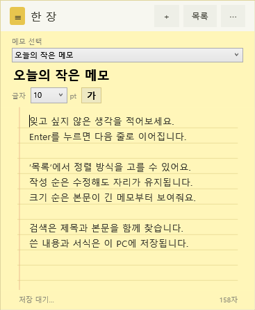

# 한 장 · YellowMemo

노란 줄노트 디자인으로 바탕화면 한쪽에 두고 사용하는 **Windows 메모 위젯**입니다. 인터넷이나 계정 없이 작성·검색·저장할 수 있습니다.



## 실행하기

1. [배포 ZIP](releases/YellowMemo-v1.0.0-windows.zip)을 다운로드해 압축을 해제합니다.
2. `YellowMemoWidget3.exe`를 실행합니다.
3. 종료할 때는 **⋯ → 앱 종료**를 선택합니다. Alt+F4는 메모를 접습니다.

Windows 데스크톱과 .NET Framework 4.x의 WPF 구성 요소가 필요합니다. 빌드 스크립트는 64비트 Windows 환경을 기준으로 합니다. macOS·Linux는 지원하지 않습니다. 설치 프로그램이나 자동 업데이트는 제공하지 않습니다.

## 기능

- 노란 배경과 얇은 가로선, 기본 10pt 글자와 22px 줄 간격
- 메모 추가·선택·삭제, 작은 창과 목록 창 전환
- 선택한 글자 또는 앞으로 입력할 글자의 크기(8~32pt)·굵기 변경
- 제목과 본문을 함께 찾는 부분 문자열 검색
- 최근 생성 순 / 본문 글자 수가 많은 순 정렬
- 입력을 잠시 멈추면 자동 저장, 직전 저장본 백업
- 창 위치·크기 기억, 접기·펼치기, 알림 영역 아이콘
- 다른 창 뒤로 이동 가능, 항상 위 기능 없음

## 저장 위치

```text
%LOCALAPPDATA%\YellowMemo\data\widget-notes.json
```

같은 PC의 같은 Windows 계정에서는 실행 파일을 다른 폴더로 옮겨도 메모가 유지됩니다. 다른 PC나 계정으로 자동 동기화되지는 않습니다. 최초 실행 시 고정 저장 위치가 비어 있으면 실행 파일 옆의 예전 `data` 폴더에서 가져옵니다.

메모는 별도의 로컬 파일이며 EXE에 포함되지 않습니다. 저장 파일은 암호화하지 않습니다. 백업과 이전 메모를 포함한 개인 사용 폴더를 GitHub에 올리지 마세요.

## 개발 문서

- [처음부터 배포 준비까지의 개발 과정](YELLOWMEMO_BUILD_GUIDE.md)
- [사용 방법·백업·PC 이동](docs/USER_GUIDE.md)
- [변경 이력](CHANGELOG.md)
- [검증 결과와 한계](docs/TEST_REPORT.md)
- [GitHub 업로드와 Release 만들기](docs/GITHUB_PUBLISH.md)

## 소스에서 빌드하기

저장소 루트에서 Windows PowerShell로 실행합니다.

```powershell
.\scripts\build.ps1
.\scripts\test.ps1
.\scripts\package.ps1
```

실행 정책으로 스크립트가 차단되면 내용을 확인한 뒤 개별 명령을 `powershell -NoProfile -ExecutionPolicy Bypass -File .\scripts\build.ps1`처럼 실행할 수 있습니다. PC 전체 실행 정책을 바꿀 필요는 없습니다.

빌드 결과는 `artifacts/build/`, 테스트 결과는 `artifacts/tests/`, 공개용 ZIP은 `releases/`에 생성됩니다. 패키지 명령은 빌드와 자동 검사 후 EXE·사용 안내만 압축합니다. npm, Python, NuGet, .NET SDK 설치는 필요하지 않습니다.

## 현재 상태

공개용으로 묶은 버전은 **v1.0.0**입니다. 이는 이번 패키지의 버전이며 과거 내부 버전 번호를 재구성한 것이 아닙니다. GitHub 게시 여부와 별개입니다.

한글 조합 중 처리를 미루도록 수정했고 자동 검사를 제공합니다. 실제 한글 IME에서 받침 입력 문제가 완전히 해소됐는지는 별도 사용자 검증이 필요합니다. 자세한 미검증 항목은 검사 보고서를 참고하세요.

## 라이선스

이 패키지에는 라이선스를 임의로 지정하지 않았습니다. 공개 저장소의 재사용 조건은 소유자가 선택해 `LICENSE`에 추가할 수 있습니다.
