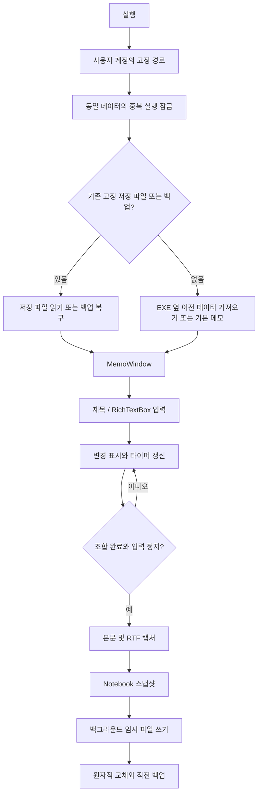

# 한 장 · YellowMemo 개발 과정과 빌드 가이드

노란 줄노트 메모장을 바탕화면 위젯으로 만들고, 실제 사용 중 나온 요구와 문제를 반영해 공개 배포 파일로 묶기까지의 기록입니다.

정리 기준일: **2026-11-01**. 앱 기능 소스는 **2026-10-17 최종 수정본**, 공개 패키지 이름은 **v1.0.0**입니다.

참고 문서의 결과물 → 구조 → 명세 → 구현 → 검증 → 배포 → 함정 → 다음 단계라는 구성을 따랐습니다. 웹 서버, API 키, Vercel 배포 등 이 앱에 해당하지 않는 내용은 제외했습니다. 이 문서는 대화에서 확인되는 요구사항과 남아 있는 최종 소스를 바탕으로 작성했습니다. 초기 버전의 전체 소스·정확한 수정 시각·Git 커밋 기록을 복원한 문서는 아닙니다.

## 1. 처음 만들고 싶었던 것

처음 요구는 중요한 내용을 메모해 바탕화면에 띄워 두는 프로그램이었습니다.

- 메모지는 노란 배경에 얇은 가로선이 있는 디자인
- Enter를 누르면 다음 줄로 이어지는 입력
- 필요에 따라 폴더를 추가해 메모를 분류하는 기능

이후 사용자가 실제로 원하는 형태가 “챗봇 펫처럼 바탕화면 한쪽에 계속 떠 있는 앱”이라는 점이 구체화됐습니다. 앱을 종료하거나 컴퓨터를 끄기 전까지 사용할 수 있는 작은 창이 핵심이 됐습니다. 여기서 “펫처럼”은 화면에 계속 두는 사용 방식이며, 캐릭터 애니메이션이나 챗봇 기능을 만들었다는 뜻은 아닙니다.

## 2. 최종 결과물

| 영역 | 최종 동작 |
|---|---|
| 실행 환경 | Windows 데스크톱, C#/.NET Framework, WPF |
| 모양 | 노란 줄노트, 기본 10pt, 22px 가로선 간격 |
| 창 | 기본 380×460 크기의 작은 창, 목록 확장, 이동·크기 조절 |
| 지속 사용 | 알림 영역 아이콘, 접기·펼치기, 명시적 앱 종료 |
| 창 순서 | 항상 위 제거, 다른 창 뒤로 이동 가능 |
| 편집 | 제목·본문, Enter, 일반 텍스트 붙여넣기, 크기·굵기 |
| 메모 관리 | 추가·선택·삭제, 폴더 UI 없음 |
| 정렬 | 최근 생성 순 / 본문 글자 수가 많은 순 |
| 검색 | 제목 또는 본문의 부분 문자열, 영어 대소문자 구분 없음 |
| 저장 | 약 900ms 입력 정지 후 저장, 한글 조합 중 지연 |
| 위치 | %LOCALAPPDATA%/YellowMemo/data |
| 통신 | 서버·네트워크·로그인·동기화 없음 |
| 배포 | EXE와 사용 안내만 들어 있는 ZIP |

파일 이름 YellowMemoWidget3.exe는 기존 사용 흐름을 유지하기 위해 남겼습니다. 파일명의 3이나 데이터의 EditorVersion=4는 이번 공개 패키지 버전 v1.0.0과 서로 다른 개념입니다.

### 공개 저장소 구조

```text
yellowmemo/
├── README.md
├── YELLOWMEMO_BUILD_GUIDE.md
├── CHANGELOG.md
├── VERSION
├── .gitignore
├── .gitattributes
├── src/
│   └── YellowMemo.cs
├── scripts/
│   ├── build.ps1
│   ├── test.ps1
│   └── package.ps1
├── docs/
│   ├── USER_GUIDE.md
│   ├── TEST_REPORT.md
│   ├── GITHUB_PUBLISH.md
│   └── RELEASE_NOTES.md
├── assets/
│   ├── widget.png
│   └── list.png
└── releases/
    ├── README.md
    ├── YellowMemo-v1.0.0-windows.zip
    └── SHA256SUMS.txt
```

artifacts는 빌드·검사 실행 시 만들어지는 로컬 출력이며 공개 폴더에 포함하지 않습니다. 실제 코드 전문은 src/YellowMemo.cs에 있습니다. 가이드 안에 중복 복사하면 수정 시 서로 다른 소스가 생길 수 있어 파일 자체를 원본으로 두었습니다.

## 3. 요구사항이 바뀐 순서

### 3-1. 기본 메모장

노란 배경, 가로선, 줄바꿈과 메모 분류가 출발점이었습니다. 최종 소스에는 메모의 ID·제목·본문과 저장 계층, 줄을 그리는 RuledPaper가 남아 있습니다. 초기 화면의 정확한 소스 스냅샷은 이번 공개 묶음에 없습니다.

### 3-2. 바탕화면 위젯으로 전환

일반 창을 열어 사용하는 것보다 작은 메모를 계속 두는 사용 방식으로 바뀌었습니다. 테두리 없는 창, 알림 영역 아이콘, 접기와 펼치기, 위치·크기 기억을 구성했습니다. 화면 밖으로 나간 창을 다시 보이는 영역에 배치하는 처리도 포함했습니다.

Alt+F4로 바로 사라지면 위젯 사용 의도와 맞지 않으므로 접기로 처리하고, 메뉴의 앱 종료를 명시적인 종료 경로로 뒀습니다. 컴퓨터를 다시 켰을 때 자동 실행하는 기능은 추가하지 않았습니다.

### 3-3. 더 많은 줄과 작은 글자

한 화면에 더 많은 입력 줄이 보이도록 기본 글자를 10pt, 줄 간격을 22px로 조정했습니다. 스크롤과 자동 줄바꿈에서도 가로선이 본문의 줄과 함께 움직이도록 선을 문서 스크롤 좌표에 맞춰 그립니다.

글자를 크게 바꿨을 때 잘리지 않도록 본문에서 사용하는 크기에 따라 선 간격을 늘립니다. 모든 글자가 작아지면 다시 촘촘하게 돌아갈 수 있습니다.

### 3-4. 글자 크기·굵기와 메모 선택

한글 워드프로세서처럼 크기와 굵기를 고르고 싶다는 요청에 따라 RichTextBox의 선택 영역에 서식을 적용했습니다. 선택이 없는 상태에서는 앞으로 입력할 글자의 서식으로 처리합니다.

본문 문자열만 저장하면 서식이 사라지므로 Body와 별개로 Base64 인코딩한 RTF를 BodyRtf에 저장합니다. 빈 메모도 글자를 입력하기 전의 크기·굵기를 유지하도록 EmptyFontSize와 EmptyBold를 기록합니다.

상단 선택 상자는 현재 메모를 바로 바꾸는 역할을 하며, 목록 창에서는 검색과 정렬을 제공합니다.

### 3-5. 폴더 기능 제거

초기에는 폴더 분류를 원했지만, 이후 필요 없다는 요청으로 최종 UI에서 제거했습니다. 다만 예전 메모를 읽을 때 데이터 구조가 달라져 유실되는 것을 피하려고 Folder·FolderId 필드는 유지했습니다.

따라서 코드에 폴더 자료형이 있다고 해서 현재 앱에서 폴더를 만들 수 있는 것은 아닙니다. 예전 폴더에 속했던 메모도 같은 전체 목록에서 볼 수 있습니다.

### 3-6. 이전 버전 정리

이전 실행 파일들을 없애고 최종 수정본만 남기라는 요청에 따라 배포용 실행 파일을 하나로 정리했습니다. 필요한 메모 원본과 복구 자료는 실행 파일과 구분해 보존했습니다.

이번 저장소에는 옛 개인 메모, 복구용 data 폴더, 작업용 파일을 가져오지 않았습니다. 이전 버전 소스를 실제 Git 이력인 것처럼 꾸며 넣지도 않았습니다.

### 3-7. 항상 위 제거

다른 창 뒤로도 갈 수 있게 해 달라는 요청에 이어 항상 위 기능 자체를 제거했습니다. UI의 선택 기능을 없애고 Topmost=false로 고정했습니다. 옛 저장 파일에 Pinned=true가 있어도 해제합니다.

알림 영역에서 사용자가 메모를 다시 여는 동작은 창을 앞으로 활성화하지만, 계속 위에 고정하는 기능은 아닙니다.

### 3-8. 작성 순과 크기 순

최근 생성한 메모가 위에 오되 예전 메모를 수정해도 위치가 바뀌지 않아야 했습니다. 수정 시각 Updated로만 정렬하면 이 요구를 만족할 수 없어 CreationOrder를 따로 추가했습니다.

- 작성 순: CreationOrder 내림차순
- 크기 순: Body.Length 내림차순, 동률이면 CreationOrder 내림차순
- 마지막 동률은 ID로 안정적으로 결정
- 선택한 SortMode를 저장해 다음 실행에도 유지

옛 파일은 생성 순서를 저장하지 않았으므로 당시의 수정 시각 기준 목록 순서를 한 번 고정합니다. 과거의 실제 생성 시각을 알아낸 것은 아닙니다. 크기 순에서 크기는 디스크 용량이나 서식 크기가 아니라 본문의 UTF-16 문자열 길이입니다.

### 3-9. 검색·오프라인·공유 확인

검색은 제목과 본문 중 어느 한쪽에 검색 문구가 있으면 찾습니다. 빈 검색어는 전체 메모, 영어는 대소문자 무시, 앞뒤 공백은 제거합니다. 제목만 정확히 일치해야 하는 검색이 아닙니다.

앱은 로컬 파일과 Windows 기능을 사용하며 네트워크 API를 호출하지 않습니다. 인터넷 없이 작성·검색·저장할 수 있습니다.

개인 메모는 EXE 안에 저장하지 않습니다. 메모가 늘면 저장 파일과 메모리 사용량이 늘고 실행 파일 크기는 그대로입니다. 예전 설치 폴더 전체를 공유하면 data와 백업도 포함될 수 있어 EXE·안내만 담은 공유용 ZIP을 만들었습니다.

### 3-10. 앱 폴더 이동 후 기록 유지 — 2026-10-17

실행 파일 옆 data 폴더를 사용하던 방식은 EXE만 옮기면 기록을 찾지 못할 수 있었습니다. 저장 경로를 Windows 사용자 계정의 고정 위치로 옮겼습니다.

```text
예전: 실행 파일 옆/data/widget-notes.json
현재: %LOCALAPPDATA%/YellowMemo/data/widget-notes.json
```

NotebookLocation.ImportLegacy는 고정 저장 파일이나 그 백업이 이미 있으면 가져오기를 건너뜁니다. 비어 있다면 EXE 옆 widget-notes.json, 초기 notes.json 순으로 확인하고 정상 데이터 또는 백업을 읽습니다. 원래 파일은 지우지 않고 유효한 파일의 바이트를 복사합니다.

원래 앱이 데이터를 쓰는 동안 복사하지 않도록 원본 잠금도 확인합니다. 같은 계정에서는 앱 위치와 메모 위치가 분리되지만, 다른 PC·계정으로 기록이 자동 이동하는 것은 아닙니다.

### 3-11. 느린 입력과 한글 받침 분리 대응 — 2026-10-17

실사용에서 받침이 있는 글자가 자모로 나뉘거나 입력이 느려지는 문제가 보고됐습니다. 예를 들어 “를”이 “ㄹㅡㄹ”처럼 보인다는 설명이 있었습니다.

기존 TextChanged 경로에서는 입력할 때마다 다음 처리를 수행했습니다.

```text
줄 간격 재적용 → 문서 전체 본문 읽기 → 전체 RTF 변환
→ 목록 갱신 → 서식 UI 갱신
```

한글은 초성·중성·종성을 조합하는 동안 같은 글자 영역을 갱신합니다. 그때 앱이 FlowDocument 속성을 바꾸는 처리는 조합을 방해할 가능성이 있고, 문서 전체 변환을 매번 하는 방식은 긴 메모에서 비용이 커집니다.

수정 후 TextChanged에서는 변경 표시와 타이머 갱신을 중심으로 처리합니다. TextCompositionManager의 조합 시작·갱신·완료를 추적하고, 조합 중에는 캡처·줄 정리·자동 저장을 미룹니다. 입력이 멈추면 필요한 본문과 RTF를 한 번 캡처합니다.

디스크 쓰기는 스냅샷을 만들어 백그라운드 Task에서 실행합니다. 저장 중 다시 입력하면 revision이 달라지므로 옛 저장 완료를 최신 내용의 저장 완료로 취급하지 않습니다. Ctrl+S와 정상 종료는 진행 중인 쓰기를 기다리고 최신 내용을 저장합니다.

목록 미리보기도 본문 전체 대신 최대 160글자를 사용합니다. 단, RTF 캡처 자체는 WPF 문서를 읽어야 하므로 UI 스레드에서 수행합니다. 모든 편집 비용을 백그라운드로 옮긴 것은 아닙니다.

자동 검사에서 조합 중 저장 지연과 긴 문서의 연속 편집 경로를 확인했습니다. 실제 IME에서 문제를 재현하고 완전히 해결됐다고 확인한 기록은 없으므로, 그 부분은 미검증으로 남겼습니다.

### 3-12. 공개 배포 파일 준비 — 2026-11-01

현재 남아 있는 마지막 소스를 찾아 앱 동작 코드는 그대로 두고 공개용 폴더를 구성했습니다. 과거의 개인 작업 경로나 개인 메모 파일을 배포에 포함하지 않습니다.

기존 빌드 과정을 저장소 구조에 맞게 옮기고, 테스트를 고유한 작업 폴더에서 실행하도록 래퍼 스크립트를 추가했습니다. package.ps1은 검사 성공 후 지정한 두 파일만 압축합니다.

공개용 버전 v1.0.0은 이 시점에 붙인 패키지 버전입니다. 아직 수행하지 않은 GitHub 게시를 완료했다고 기록하지 않습니다.

## 4. 동작 구조



| 코드 영역 | 책임 |
|---|---|
| Note, Notebook, Folder | 메모·설정·이전 구조 호환 |
| NoteView | 생성 순서 초기화, 정렬, 문자열 검색 |
| Store | JSON 읽기·검증, 임시 파일 쓰기, 교체와 백업 |
| NotebookLocation | 고정 경로 결정, 이전 파일 가져오기 |
| RuledPaper | 문서 스크롤에 맞춘 선 그리기 |
| MemoWindow | 위젯 UI, 서식, 입력, 자동 저장, 트레이 |
| Program | 시작, 중복 실행 잠금, 복구, 검사 모드 |

단일 C# 소스에 UI와 저장, 검사 코드가 들어 있습니다. 작은 프로그램을 단순하게 빌드하기 위한 현재 구조이며, 규모가 커지면 편집기·저장소·테스트를 분리할 수 있습니다.

## 5. 주요 데이터와 실패 처리

### 메모 데이터

Note는 Id, FolderId, Title, Body, BodyRtf, EmptyFontSize, EmptyBold, Updated, CreationOrder를 저장합니다. Notebook은 메모 목록과 마지막 선택, 정렬 방식, 위젯 위치·크기, 이전 호환 설정을 가집니다.

Body는 검색·글자 수·텍스트 복구에 사용합니다. BodyRtf를 읽지 못하면 일반 Body로 문서를 다시 만듭니다. 본문이 비어 있을 때의 입력 서식은 별도 필드로 복구합니다.

### 파일 저장

1. 저장 전에 데이터와 ID·폴더 연결의 유효성을 검사합니다.
2. .tmp에 JSON을 쓰고 Flush(true)로 반영합니다.
3. 기존 파일이 있으면 File.Replace로 교체하며 .bak를 남깁니다.
4. 처음 저장하는 파일이면 임시 파일을 현재 파일로 이동합니다.

현재 파일이 손상됐고 정상 백업이 있으면 시작 시 백업을 복구하고 손상 파일을 따로 남깁니다. 저장 실패 시 성공 표시를 하지 않고 Ctrl+S로 다시 시도하도록 표시합니다. 백업은 전체 편집 이력이나 삭제 취소 기능이 아닙니다.

저장 파일에는 암호화가 없습니다. Base64 RTF는 서식 직렬화 방식이며 보안 수단이 아닙니다.

## 6. 같은 결과물을 빌드하는 순서

### 6-1. 환경

64비트 Windows에 .NET Framework 4.x의 컴파일러와 WPF 구성 요소가 필요합니다. 스크립트는 Windows의 Microsoft.NET/Framework64/v4.0.30319/csc.exe를 사용합니다.

C# 컴파일러, PresentationFramework, PresentationCore, WindowsBase, System.Xaml, System.Runtime.Serialization, Windows.Forms, Drawing을 참조합니다. 외부 패키지 복원이나 네트워크는 필요하지 않습니다.

### 6-2. 빌드

```powershell
.\scripts\build.ps1
```

기본 결과는 artifacts/build/YellowMemoWidget3.exe입니다. 선택적으로 -OutputPath를 넘길 수 있습니다. 컴파일 실패 시 스크립트가 오류로 끝납니다.

### 6-3. 자동 검사

```powershell
.\scripts\test.ps1
```

고유한 artifacts/tests 하위 폴더를 만들고 --self-test와 --smoke-test를 실행합니다. 정상 모드로 개인 메모를 열지 않습니다. 제한 시간을 넘기면 해당 검사 프로세스만 종료하고 실패합니다.

UI를 사용할 수 없는 환경에서는 -StorageOnly로 저장 검사만 할 수 있습니다. 저장 검사만 성공했다고 UI 검사까지 통과한 것은 아닙니다. 이 저장소에는 원격 CI의 GUI 동작을 보장하는 워크플로를 넣지 않았습니다.

### 6-4. 공개 ZIP

```powershell
.\scripts\package.ps1
```

빌드 → 자동 검사 → EXE·USER_GUIDE.md 압축 → ZIP 내부 이름 확인 → EXE 해시 비교 → ZIP SHA-256 기록 순서입니다.

컴파일 결과는 빌드마다 메타데이터 등이 달라질 수 있으므로 서로 다른 빌드가 같은 해시가 된다고 보장하지 않습니다. 제공한 SHA256SUMS는 함께 제공한 ZIP을 확인하기 위한 값입니다.

## 7. 검증 범위

| 자동 검사 | 확인하는 내용 |
|---|---|
| 저장 | 한글·이모지·여러 줄 왕복, 검증 실패 시 원본 유지, 백업 |
| 이전 | 바이트 보존, EXE만 이동한 경로, 기존 저장 우선, 백업 가져오기, 잠금 |
| 정렬 | 생성 순서 유지, 크기 변경, 동률, 재실행 설정 |
| 검색 | 제목·본문·부분 문구·영문 대소문자·여러 결과·없음·빈 검색 |
| 서식 | 선택 부분 크기·굵기, 실행 취소, 빈 문서 입력 서식 |
| 줄과 창 | Enter·줄바꿈·스크롤·큰 글자, 접기·펼치기·위치 보정 |
| 입력 | 긴 문서에서 매 키 RTF 변환 없음, 조합 중 지연, 종료 직전 보존 |

긴 문서 검사는 프로그램적으로 AppendText를 반복하는 회귀 검사입니다. 물리 키보드의 IME, 체감 지연, 모든 문서 크기를 대신하는 벤치마크는 아닙니다. 최신 실행 결과와 미검증 항목은 [검사 보고서](docs/TEST_REPORT.md)를 확인하세요.

### 실제 사용자 환경에서 남은 확인

- Microsoft 한글 IME에서 “를”, “읽고”, “값을”, “앉았다”를 천천히·빠르게 입력
- 조합 도중 1초 이상 멈춘 뒤 받침을 이어 입력
- 제목과 본문을 바꾸며 입력, Enter·Backspace·실행 취소 확인
- 글자 크기·굵기 변경 전후의 입력 확인
- 긴 문서와 여러 메모를 사용하는 상태의 체감 지연 확인
- 새로운 Windows 계정 또는 PC에서 첫 실행과 이전 데이터 가져오기

## 8. 배포

이 앱은 데스크톱 EXE이므로 웹 호스팅을 하지 않습니다. GitHub에는 소스·문서·배포 파일을 올리고, Release에는 사용자용 ZIP과 체크섬을 첨부합니다.

공개 파일의 경계는 package.ps1의 명시적 파일 목록과 .gitignore로 관리합니다. .gitignore가 모든 압축·공유를 막는 것은 아니므로 앱 사용 폴더 자체를 통째로 업로드하지 않습니다.

계정 이름이나 원격 주소를 임의로 넣지 않았습니다. 실제 저장소 생성과 push, Release 작성 순서는 [GitHub 배포 안내](docs/GITHUB_PUBLISH.md)에 있습니다.

## 9. 개발 중 배운 점과 주의할 부분

1. 오래 떠 있는 위젯과 항상 위 창은 다른 요구입니다. 사용자가 다른 창 뒤에 두고 싶어 하는 상황도 지원해야 합니다.
2. 폴더 UI 제거와 데이터 스키마 삭제는 같은 작업이 아닙니다. 옛 기록을 읽는 호환 필드는 남길 수 있습니다.
3. 생성 순서와 수정 시각을 분리해야 오래된 메모를 편집해도 정렬이 흔들리지 않습니다.
4. 한글 조합 중에는 입력기가 문서를 수정합니다. TextChanged에서 문서 전체를 다시 만지지 않아야 합니다.
5. 저장 성능은 디스크 쓰기뿐 아니라 문서 읽기·RTF 변환·목록 갱신 비용도 살펴야 합니다.
6. 백그라운드 저장은 옛 스냅샷의 완료를 최신 상태로 오인하지 않도록 변경 세대를 구분해야 합니다.
7. EXE 이동과 사용자 데이터 이동을 분리하면 같은 계정에서 앱 경로 변경에 견딜 수 있습니다.
8. 공유용 파일은 개인 사용 폴더를 압축해 만들지 않고 필요한 파일만 지정해 만드는 편이 명확합니다.
9. 자동 검사 통과와 실제 IME 입력 검증은 구분해서 설명해야 합니다.
10. 손상된 저장 파일을 빈 기본 메모로 조용히 덮어쓰면 안 됩니다. 읽기 실패·백업 복구·원본 보존을 구분해야 합니다.

## 10. 현재 상태와 다음 단계

현재 완료된 범위는 마지막 수정본의 소스 보존, 공개 폴더 구성, 빌드·검사·배포 ZIP, 사용자 안내와 개발 기록입니다. 실제 GitHub 업로드·Release 게시, 코드 서명, 설치 프로그램, 자동 업데이트는 수행하거나 구현하지 않았습니다.

추후 후보는 실제 IME 재현 자동화, 데이터 내보내기·가져오기 UI, 삭제 복구, 대용량 메모의 추가 성능 개선, UI·저장·테스트 코드 분리입니다. 이는 완료된 기능 목록이 아니라 다음 작업 후보입니다.

## 부록. 코드를 따라 읽는 순서

1. Program.Main으로 시작·복구·잠금 순서를 확인합니다.
2. NotebookLocation과 Store로 메모가 어디에 어떻게 저장되는지 봅니다.
3. NoteView에서 정렬·검색 규칙을 확인합니다.
4. MemoWindow.Build와 ShowNote로 화면과 데이터 연결을 확인합니다.
5. CompositionStarted/Finished, Capture, SaveInBackground, Save로 입력과 저장 경계를 읽습니다.
6. SmokeTest, TestDeferredInput, SelfTest, TestRelocation으로 회귀 검사의 범위를 확인합니다.

전체 소스: [src/YellowMemo.cs](src/YellowMemo.cs) · 빌드: [scripts/build.ps1](scripts/build.ps1) · 패키지: [scripts/package.ps1](scripts/package.ps1)
